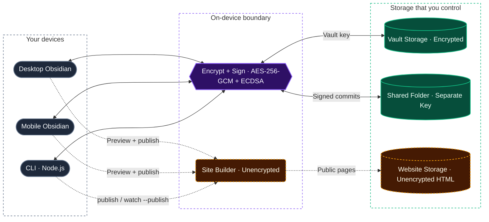
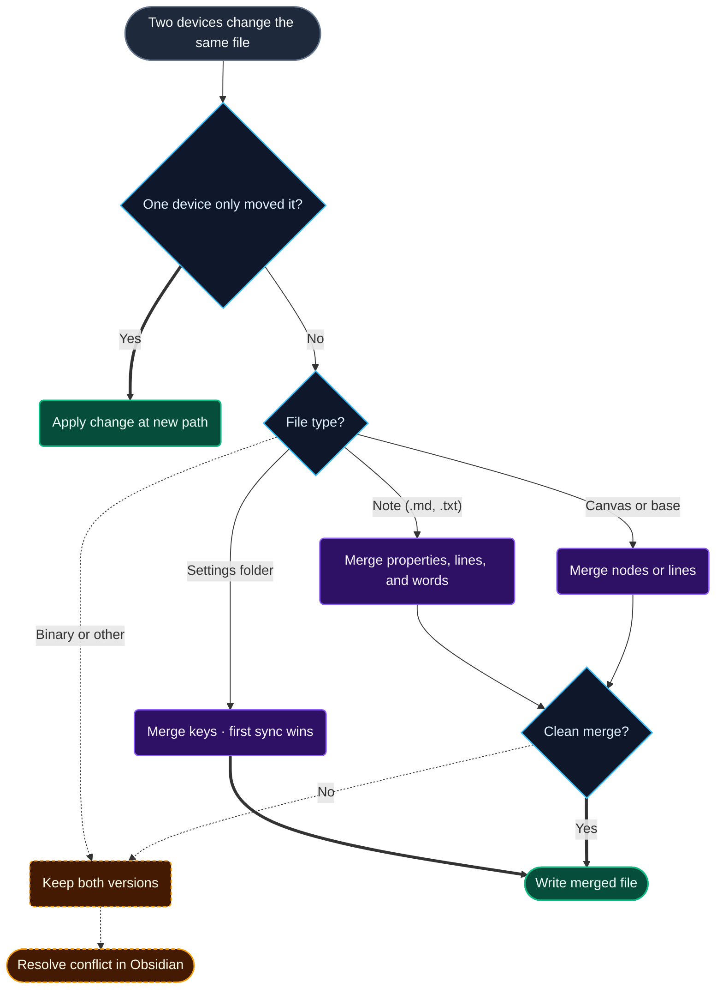
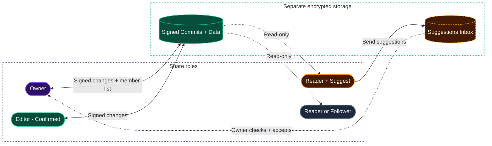
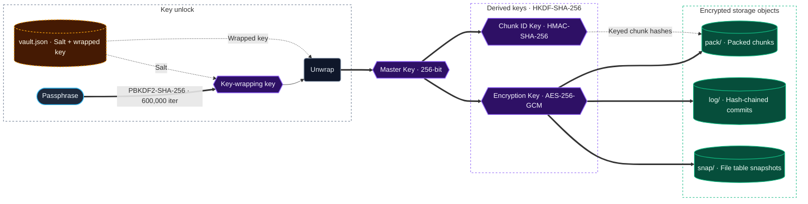

# Coffer

Coffer syncs your Obsidian vault between desktop and mobile devices through storage that you control. It supports S3-compatible buckets (Cloudflare R2, Backblaze B2, Amazon S3, MinIO, Wasabi, and others) and WebDAV servers (Nextcloud or a NAS).

Coffer encrypts all data on your device before upload. Your storage provider gets only data that it cannot read. Coffer also keeps file history, merges changes across devices, shares folders, and can publish notes as a website.

> Coffer is at version 0.7. It passes 828 tests and runs on macOS and iOS, but keep a backup of important vaults.



## Before you start

- **Network access.** Coffer connects only to your storage, and to your website location if you publish. It sends no analytics, no telemetry, and no update checks. It uses Obsidian `requestUrl`.
- **Cost.** Coffer is free and needs no account. Your storage provider sets storage costs, if any. Cloudflare R2 and Backblaze B2 give 10 GB free tiers.
- **Passphrase.** Your passphrase is the only key. If you lose it, no person can decrypt your synced data. Keep it in a password manager.
- **Vault files.** Coffer reads and writes only inside your vault, which includes its settings folder.
- **Website.** Published web pages are not encrypted. In Obsidian, Coffer uploads pages only after you run the publish command and select **Publish** in the preview.
- **One sync tool.** Do not put a Coffer vault in iCloud Drive, Dropbox, OneDrive, or Obsidian Sync at the same time.

## Install and setup

Coffer needs Obsidian 1.13.1 or later.

- **From Obsidian:** Open **Settings → Community plugins → Browse**. Search for **Coffer**. Install and enable it.
- **Manual install:** Download `main.js`, `manifest.json`, and `styles.css` from the [latest release](../../releases/latest). Put them in `<vault>/.obsidian/plugins/coffer/`. Enable Coffer under **Settings → Community plugins**.

### First device

1. Make a bucket or WebDAV folder and an access key for it. See [Storage providers](#storage-providers).
2. In Obsidian, run **Coffer: Set up sync** from the command palette.
3. Select **This is my first device**. Select your provider. Enter the storage details. Coffer tests the storage before it continues.
4. Enter a passphrase of at least 8 characters, or select **Suggest a passphrase**. Keep it in a password manager.
5. Wait for the first sync to finish. Select **Copy setup link**.

### More devices

1. Install Coffer on the other device in a new, empty vault.
2. Open the setup link. You can also run **Coffer: Set up sync**. Select **I already sync another device**, then paste the link.
3. Enter your passphrase. Select **Connect**.

Coffer encrypts the setup link with your passphrase. Protect it as a password. You can copy it again under **Settings → Coffer → Add another device**.

## Storage providers

Use a key limited to one bucket. A read-only device can use a read-only key.

| Provider | Setup details |
| --- | --- |
| Cloudflare R2 | Account ID, bucket, and an R2 API token with read and write access to that bucket |
| Backblaze B2 | Bucket endpoint (for example, `s3.us-west-004.backblazeb2.com`), bucket, and a key limited to that bucket |
| Amazon S3 | Bucket region, bucket, and an access key |
| Other S3-compatible | Endpoint, region if necessary, bucket, keys, and path-style setting (necessary for MinIO and most self-hosted servers) |
| WebDAV | Folder address, user name, and password (use an app password for Nextcloud). Coffer makes the folder if it is not present |

With **Folder in bucket**, one bucket can contain more than one vault. No CORS configuration is necessary.

For Amazon S3, this IAM policy is sufficient (replace `my-notes`):

```json
{
  "Version": "2012-10-17",
  "Statement": [
    { "Effect": "Allow", "Action": ["s3:ListBucket"], "Resource": "arn:aws:s3:::my-notes" },
    { "Effect": "Allow", "Action": ["s3:GetObject", "s3:PutObject", "s3:DeleteObject"], "Resource": "arn:aws:s3:::my-notes/*" }
  ]
}
```

Turn on bucket versioning with a 30-day rule as a second backup.

## Sync

- **Files.** Coffer syncs all vault files up to the size limit (500 MB on desktop and 200 MB on mobile by default). Larger files stay on their device, and Coffer lists them as problems. Coffer also syncs the settings folder (settings, themes, and plugins, without workspace layout), which you can turn off under **Settings → Coffer → What to sync**. Files and folders whose names start with a dot (except the settings folder) and patterns under **Leave out** do not sync.
- **Timing.** Coffer syncs at startup, a few seconds after a change, on a regular schedule, and more frequently when another device syncs. On mobile, it sends changes before the mobile OS stops the app. You can adjust these intervals in settings.
- **Merges and conflicts.** Coffer merges note changes from two devices line by line and word by word, and merges properties key by key. It keeps lines that two devices add at the same position. It merges canvases node by node, bases line by line, and settings files key by key. If one device moves a note and another device changes it, Coffer applies the change at the new location. If Coffer cannot merge two versions, it keeps both copies. Use **Resolve a file changed on two devices** to resolve conflicts (line by line for text).
- **History and restore.** Coffer keeps all versions for 1 day, hourly states for 1 week, and daily states for 30 days by default. You can restore a file version, restore deleted files, or return a folder or vault to an earlier time with a preview.
- **Files on demand.** Under **Settings → Coffer → What to sync**, set **Download only when asked** to keep large files only in storage. Run **Download a file left in storage** to download and open one. This device does not delete a file that it did not download.
- **Read-only devices.** For a read-only device, turn on **Only receive changes** at setup or under **Settings → Coffer → Storage and passphrase**. Local changes stay on that device. Remote changes merge with local files or make a conflict copy. Coffer downloads local files again if you delete them.
- **Safety checks.** A sync that deletes more than 10 files and half of the vault stops and asks first. Run **Sync now, allowing large deletions in the vault** to continue. Run **Check synced data for damage** to test stored data. Run **Repair synced data from this device's files** to upload missing or damaged data again.

### Merge flow



## Shared folders

Add a shared folder under **Settings → Coffer → Shared folders**. Each shared folder uses its own encrypted storage, separate from your vault. People in a share do not get a key to your other notes.



- **Members.** Invite each person with a link that expires. No passphrase is necessary. An edit invite works for one device. That device only gets changes until one of your devices confirms it on the next sync. Members can edit, only read, or read and suggest. Devices sign all changes and accept changes only from current editors. This rule holds if a storage key can write.
- **Suggestions.** Members who suggest send changes from their device for you to check. You decide which files to accept.
- **Removal.** Remove a member under **Members** to stop their future changes. To prevent access to new data, replace the storage keys with **Give everyone new storage keys**.
- **Limited keys and follow links.** For S3, R2, and B2, Coffer shows limited key rules for each role where the provider supports them. Give members a limited key, not your own key. For public read-only storage, a follow link gives access without storage keys. You cannot remove a follower without a new share in different storage.
- **Share by property.** Select a name (for example, `Family`) to share notes with `share: Family` and their embedded attachments. This share is one-way (read, or read and suggest) from one device. If you remove `share: Family` from a note, the note stays shared until you remove it under **What's shared**.
- **Other devices and activity.** Your other devices show the shared folder. You can add it with one tap. Run **Show recent changes** to list who changed each file. Passphrase-based shared folders continue to work.

> A member with a write key can delete objects or add invalid data in storage. That stops sync until the owner removes the invalid data, but devices do not accept their changes.

## Website

Coffer can publish notes as static web pages with their images, audio, video, and PDF files. Published pages are **not encrypted** and go to a separate storage location. In Obsidian, Coffer publishes nothing until you run the publish command and select **Publish** in the preview.

- **Select notes.** Add `publish: true` to note properties. You can also run **Put the current note on the website** or **Take the current note off the website**. To publish all notes without `publish: false`, turn on **Publish the whole vault** under **Settings → Coffer → Website**. List private folders (for example, `Private/` or `Templates/`) under **Keep off the website** first. Then check the preview.
- **Destination.** Add a separate S3 bucket or WebDAV folder with its own key under **Settings → Coffer → Website**. Coffer does not accept your vault storage or shared-folder storage. Make the destination public through your storage provider.
- **Publish.** Run **Publish notes to the website…** to preview new, changed, and deleted files before upload. Coffer uploads only changed files and deletes removed pages.
- **Output.** Each note becomes an HTML page at its vault path (`Folder/Note.html`), with an `index.html` front page, backlinks, and one light/dark stylesheet. Pages have no scripts and no trackers. Coffer does not include note properties (except `title`), `%%comments%%`, HTML comments, hidden folders, conflict copies, and (in Obsidian) shared folders. Coffer shows links to unpublished notes as plain text and embedded notes as links. Coffer renders Markdown itself. As a result, Coffer shows plugin syntax (for example, Dataview, Mermaid, or math) as source text.
- **Privacy.** Page URLs include file and folder names. Coffer uploads images without changes, which includes any location metadata inside them. If you remove a page, caches, copies that others made, and old versions in a versioned bucket stay available. Coffer records uploaded files in `coffer-site.json` and deletes only files in that list.

## Command line

The same sync engine runs on Node.js 22.18 or later for an always-on computer. Download `coffer.js` from the release and run it without installation. If Node stops with `Cannot use import statement outside a module`, rename the file to `coffer.mjs`. To check the release build, run `gh attestation verify coffer.js --repo chauduyphanvu/obsidian-coffer`. From a source clone, run `npm run cli -- <command>`.

```sh
node coffer.js watch --config=coffer.json
```

Example `coffer.json`:

```json
{
  "vault": "/path/to/vault",
  "remote": { "type": "s3", "endpoint": "https://s3.us-east-1.amazonaws.com", "region": "us-east-1", "bucket": "my-notes", "prefix": "Notes", "pathStyle": false },
  "sync": { "deviceName": "nas" }
}
```

Set secrets in environment variables:

- **Vault:** `COFFER_PASSPHRASE` (and `COFFER_NEW_PASSPHRASE` for passphrase changes, at least 8 characters), `COFFER_ACCESS_KEY` and `COFFER_SECRET_KEY` (S3), or `COFFER_WEBDAV_PASSWORD` (WebDAV).
- **Website:** `COFFER_SITE_ACCESS_KEY` and `COFFER_SITE_SECRET_KEY` (S3), or `COFFER_SITE_WEBDAV_PASSWORD` (WebDAV).

### Common commands

Run `node coffer.js --help` for all commands. Other commands include `sync`, `check`, `history`, `restore`, `deleted`, `log`, `activity`, `restore-at`, `verify`, `repair`, `clean`, `change-passphrase`, and `accept-storage`.

- `watch`: Keep the vault in sync continuously. Add `--publish` to publish the website automatically after the first sync and after syncs that change data, without a prompt.
- `status`: Check storage access, device sync state, deferred files, and conflict copies. It writes nothing to storage. Add `--json` for scripts. It exits `1` on storage errors, history problems, or conflict copies.
- `export <dir>`: Write a decrypted copy of the vault into an empty folder outside the vault. Add a vault subfolder or `--at=<time|commit>` for partial or point-in-time backups.
- `publish`: Publish the website from `site` in `coffer.json` without a passphrase or sync keys. It supports `s3`, `webdav`, or an external `folder`. It uploads without a prompt. Add `--dry-run` to preview changes without upload.
- `fetch <path>...`: Download files that `sync.deferAboveMB` keeps in storage.
- `join -`: Join or follow a shared folder through standard input. Example: `pbpaste | node coffer.js join - --config=family.json --vault=Family`. The CLI cannot be the owner of a shared folder, send suggestions, or share by property.

Set `"readOnly": true` under `sync` for a read-only computer. To publish a website, add a `site` block to `coffer.json`. Include `remote`. You can also add `title`, `home`, `"whole": true`, and `exclude`.

## Security and limits



- **Encryption.** Coffer uses AES-256-GCM to encrypt file contents, file names, folder names, and device names. In a vault, `vault.json` is the only unencrypted object. It contains the vault key wrapped with PBKDF2-SHA-256 (600,000 iterations for a new vault). Separate derived keys encrypt data and calculate keyed chunk hashes. Storage cannot test if you have a file.
- **Storage layout.** Coffer divides files into content-defined chunks, compresses text, keeps matching chunks one time, and packs them into `pack/`. Numbered commits (`log/`) include the previous commit hash and write only when the number is free. Devices do not overwrite changes. Periodic snapshots (`snap/`) record the full file table.
- **Provider visibility.** Your storage provider sees only object counts, sizes, and write times.
- **Passphrase change.** Coffer wraps the vault key again in `vault.json` without a new upload of vault data. Other devices ask for the new passphrase on the next sync.
- **External deletions.** If an external tool deletes storage objects, weekly cleanup and **Check synced data for damage** list affected files. **Repair synced data from this device's files** restores them from a device that has them. You cannot restore data that is missing from all devices.
- **Storage rollback.** If storage returns to an older state, a device detects it on its next upload, or in less than 1 hour when idle. In a member-shared folder, a device with an old invite can accept storage from before a removal until you replace the keys.
- **Device status.** The "changes behind" count for another device can be a few minutes old.

## Build from source

```sh
npm ci
npm run build      # dist/main.js, dist/manifest.json, dist/styles.css, dist/coffer.js
npm test
```

## License

[MIT](LICENSE)
